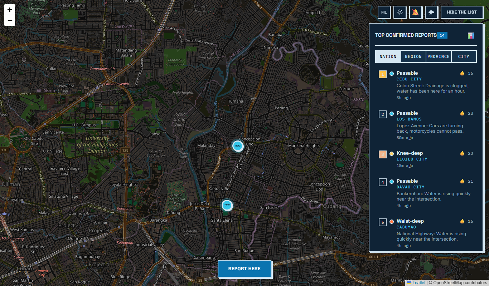
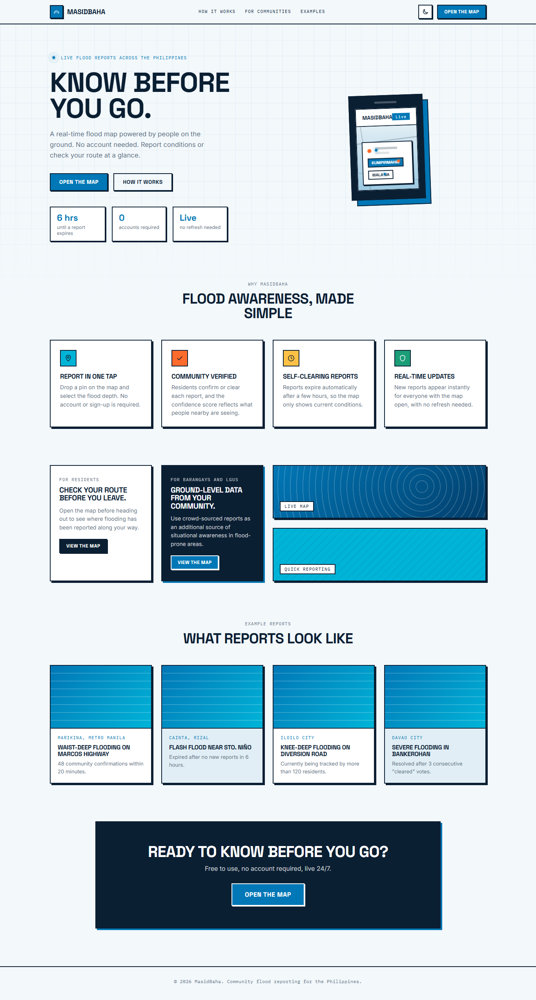
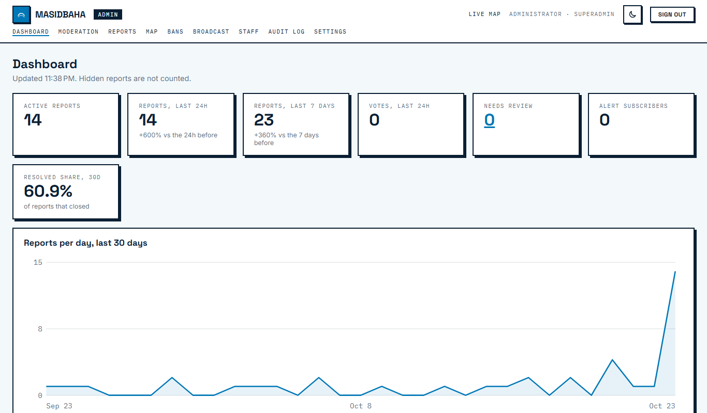
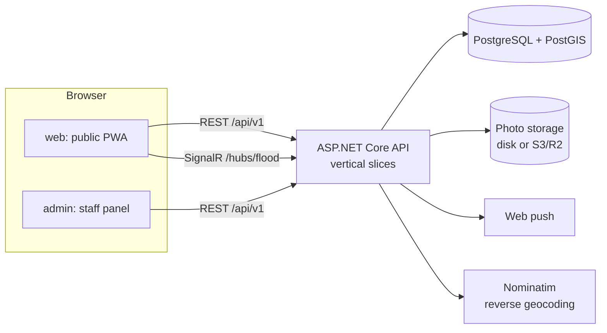

# MasidBaha

**Know before you go.** MasidBaha is a community flood-reporting map for the Philippines. People pin
flooded roads from their phones, neighbours confirm or clear them, and everyone nearby sees what is
passable right now. Nobody has to sign up, because nobody signs up during a flood.



## What it does

- **Live map.** Reports appear on everyone's map within a moment (SignalR). Each has a severity, an optional
  photo, a place name and a confidence score built from community votes and the reporter's track record.
- **Anonymous but accountable.** Reporting and voting need no account. The server issues a signed session
  cookie, rate-limits writes, expires reports after a few hours and lets staff ban abusers.
- **Alerts that matter to you.** Web push for new serious reports. Choose up to five places you care about
  and you hear only about floods near them. Staff can broadcast announcements, to everyone or only to people
  near an area.
- **Weather context.** Optional rain radar, satellite rainfall and typhoon tracks on the map, with links to
  PAGASA for official warnings.
- **Easy to share.** Every report has a share link with a proper preview card on Facebook, Messenger and Viber.
- **History.** A heatmap and analytics of where and how often it floods.
- **Works as an app.** An installable PWA that keeps working on a weak connection.
- **Admin portal.** Moderators review flagged reports, ban sources, send announcements and tune settings;
  everything staff do is in an audit log. Staff sign in with a password and optional two-factor.

| Public site | Admin panel |
|---|---|
|  |  |

## How it fits together



- **Backend:** .NET 10, ASP.NET Core, EF Core with PostGIS, SignalR, ASP.NET Identity for staff.
  Organised by feature (`Application/<Area>/<UseCase>`) instead of by layer. See [docs/backend.md](docs/backend.md).
- **Database:** PostgreSQL with PostGIS: `geography` points, a GiST index, and `ST_DWithin` for radius
  search. See [docs/database.md](docs/database.md).
- **Frontend:** an Angular 22 workspace with three projects: `web`, `admin` and a `shared` library
  (API clients, models, UI pieces, design tokens). Signals, OnPush and standalone components throughout.

## Run it locally

You need Docker, the .NET 10 SDK and Node 22.

**Everything in containers (quickest look):**

```
docker compose --profile app up --build
```

Then open the public site at <http://localhost:8080> and the admin panel at <http://localhost:8081>.
The admin login is `admin@masidbaha.local` / `local-demo-admin-password`, and demo reports are loaded.
These defaults are for local use only; see the top of `docker-compose.yml` for how to override them.

**For development:**

```
docker compose up -d                       # PostgreSQL + PostGIS on localhost:5433
pwsh ./scripts/init-dev-secrets.ps1        # stores local secrets outside the repo (first time only)

cd backend/MasidBaha.WebAPI
dotnet run --launch-profile https          # API on https://localhost:7252

cd frontend
npm install
npx ng serve web                           # http://localhost:4200
npx ng serve admin                         # http://localhost:4201
```

The first admin comes from the `AdminAuth:InitialAdmin` secrets (a real email and a password of at least
12 characters). If you can't sign in from the browser, make sure you started the API with
`--launch-profile https`; the apps call `https://localhost:7252`.

## Tests

```
cd backend  && dotnet test MasidBaha.slnx      # needs Docker: the integration tests start PostGIS
cd frontend && npm run lint && npm test
```

Backend tests run the real application against a throwaway PostGIS container (Testcontainers), including
the HTTP pipeline: authorization by role, bans, two-factor, rate limits. CI runs all of this on every
pull request, plus CodeQL.

## Deploy

The repo is set up for Neon (Postgres), Render (API) and Cloudflare Pages (sites) on free tiers.
The step-by-step guide is in [docs/deploy.md](docs/deploy.md).

## Engineering decisions

- **The database does the geography.** Radius queries use `ST_DWithin` on a GiST-indexed `geography`
  column, so the index is used. A plain distance comparison would scan the whole table.
- **Anonymous reporting, with guardrails.** Low friction is the point. It is balanced by a signed session
  cookie, rate limits, community votes, a trust score per reporter, expiry, and staff tools (shadow bans
  that look like success to the abuser).
- **Expiry is a query-time filter.** Whether a report is still shown never depends on a background job
  having run, which matters on free hosts that sleep.
- **Privacy.** Photos have their EXIF data stripped, a report holds only the location the user pinned,
  and IP addresses are stored only as a keyed hash that cannot be reversed.
- **Vertical slices, not layers.** Each use case keeps its request, validation and logic together.
- **One origin in production.** A small proxy keeps the sites and API on the same origin, so cookies
  stay first-party without CORS or `SameSite=None`.
- **A real bug, caught by a test.** `(byte)VoteType.Deny` is 255, so every "it's gone" vote used to add
  255 to a report's confidence instead of removing one.

## Roadmap

- Route check: "can I get from A to B?" against active reports.
- Offline report queue with background sync.
- Filipino / English language toggle.

See [CHANGELOG.md](CHANGELOG.md) for what has shipped.
