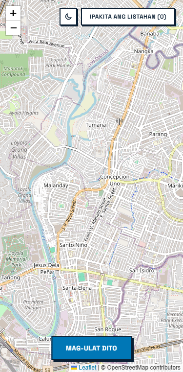
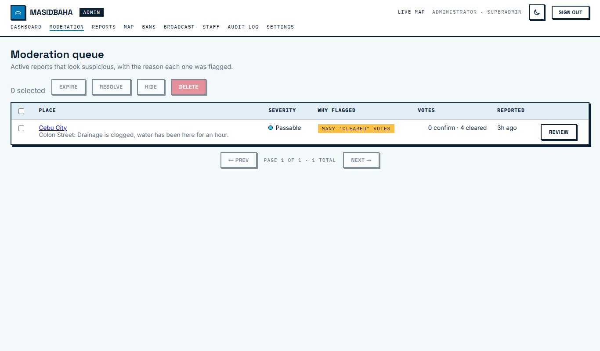
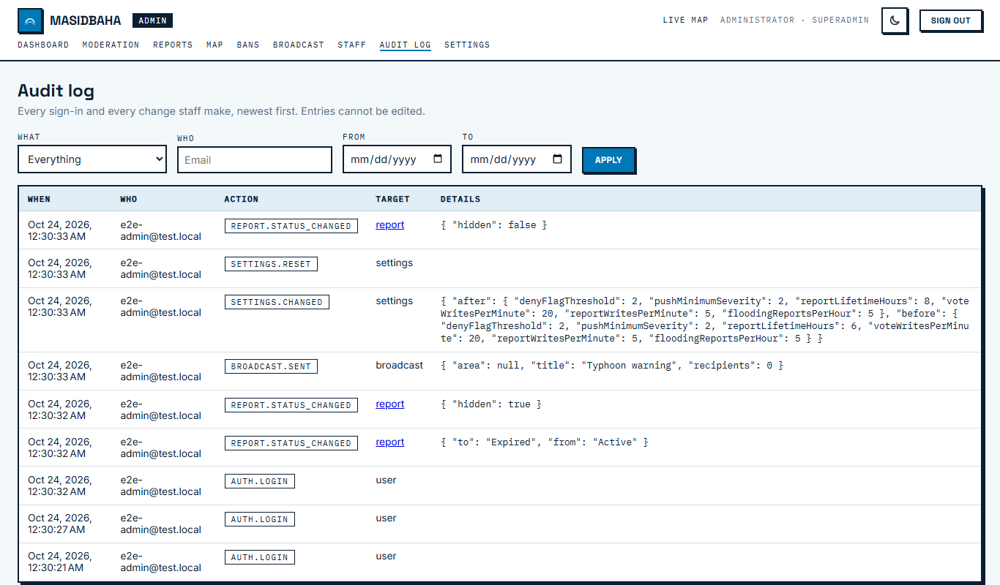
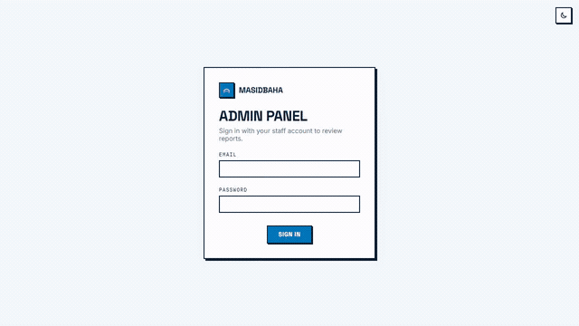
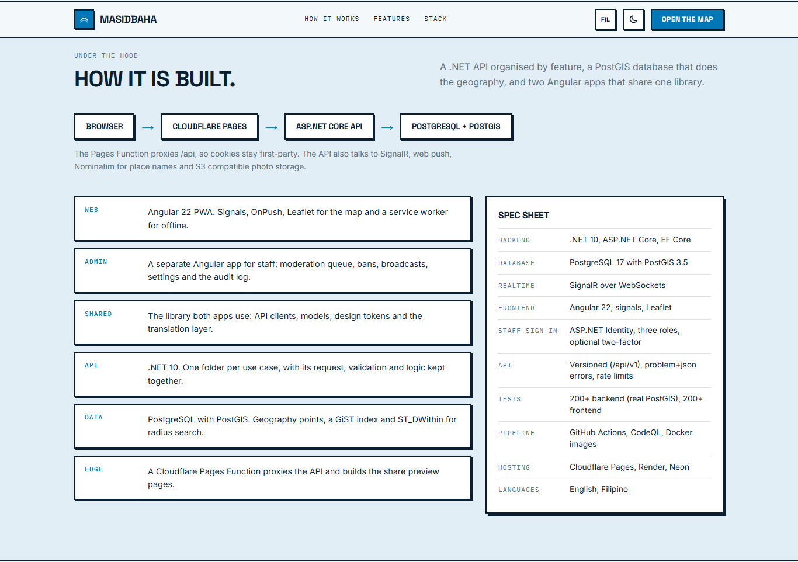
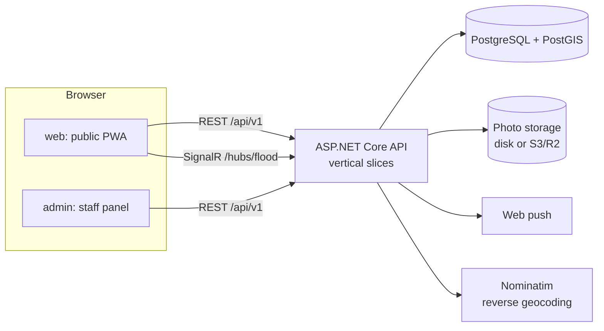

# MasidBaha

A flood monitoring app for the Philippines. Anyone can pin a flooded road from their phone, neighbours confirm it or say it has cleared, and the map stays current without accounts or someone sorting reports by hand. Nobody signs up during a flood, so nobody has to.

Built with .NET 10, Angular 22 and PostgreSQL with PostGIS.

**[Live demo](https://masidbaha.pages.dev)**

The demo runs on free hosting that sleeps when idle, so the first request after a quiet spell can take up to a minute while the API and database wake up. Photos uploaded to the demo are cleared whenever the server restarts.


| Landing page | On a phone |
|---|---|
|  |  |

| Moderation queue | Audit log |
|---|---|
|  |  |

## Demo

**The public site:** the landing page, confirming a report, posting a new one, the rain radar, satellite rainfall and typhoon track overlays, dark mode and the Filipino translation.


**The admin panel:** signing in, the dashboard, the moderation queue, hiding a report, the map, announcements and the audit log that records the change.



## What it does

| Area | What you get |
| --- | --- |
| Reporting | Drop a pin, pick a depth (passable, knee-deep, waist-deep, impassable), add a note and a photo. No account. |
| Confirming | Neighbours confirm a report or say it has cleared. A score of zero or less resolves it, and reports expire after a few hours. |
| Live map | New reports reach every open map through SignalR. Nearby reports collapse into one numbered badge until you zoom in. |
| Alerts | Web push for serious reports. You can watch up to five places and only hear about floods near them. |
| Weather | Optional rain radar, satellite rainfall and typhoon tracks, marked as unofficial, with links to PAGASA. |
| Sharing | Every report has a link with a preview card for Facebook, Messenger and Viber. |
| No signal | A report made offline is saved on the phone and sent when the connection returns. |
| Languages | English and Filipino. A first visit follows the browser. |
| History | A heatmap of where and how often it floods. |
| Staff | Moderators review flagged reports, ban sources and send announcements. Everything they do goes into an audit log. |

## Why it is built this way

**Anonymous on purpose, with limits.** A flood is a bad time for a sign-up form, so there are no accounts. A signed session cookie ties votes and rate limits to a browser. Reports expire, votes move a confidence score, and staff can shadow ban a source, which looks like success to the sender and shows nothing to anyone else.

**The database does the geography.** Reports are `geography(point)` values with a GiST index, and "what is flooded near here" is an `ST_DWithin` query. A plain distance comparison would scan the whole table. See [docs/database.md](docs/database.md).

**Expiry is a query filter, not a job.** Whether a report still shows never depends on a background task having run. That matters on free hosts that sleep.

**Features are vertical slices.** Each use case keeps its request, validation and logic in one folder, instead of spreading it across controllers, services and repositories. See [docs/backend.md](docs/backend.md).

**One origin in production.** A small Cloudflare Pages Function proxies `/api`, so the sites and the API share an origin. Cookies stay first-party without CORS or `SameSite=None`. The same function builds the share preview pages, because link previews are read from HTML and not from a single-page app.

**A resend can never make a duplicate.** Every report carries an id the app makes up. If the first answer is lost on a bad connection, the retry returns the first report. The unique index is on that id alone, because a first-time visitor whose answer was lost never received a session cookie either.

**Photos are treated as untrusted.** Uploads are decoded, resized and saved again, which drops EXIF and any GPS data. Only JPEG, PNG and WebP are decoded at all, whatever the upload claims to be.

## Architecture





```
backend/MasidBaha.Application   Features (one folder per use case), persistence, geocoding, weather
backend/MasidBaha.WebAPI        Controllers, SignalR hub, auth, rate limits, background services
backend/MasidBaha.Tests         xUnit. Integration tests run the real app against a PostGIS container
frontend/projects/web           The public PWA
frontend/projects/admin         The staff panel
frontend/projects/shared        API clients, models, design tokens, translation layer
frontend/functions              Cloudflare Pages Functions: the API proxy and the share pages
```

## Things worth knowing

**The weather layers are not from PAGASA.** PAGASA has no public map or data service, and scraping its pages would break. The layers use RainViewer (radar), NASA IMERG (satellite rainfall) and JTWC through GDACS (typhoon tracks), are labelled as unofficial, and link out to PAGASA for official warnings. The typhoon feed is slow, so the API refreshes it in the background and keeps the last copy in the database.

**A real bug a test caught.** `(byte)VoteType.Deny` is 255, so every "cleared" vote used to add 255 to a report's confidence instead of removing one.

**A hidden report is a 404.** A report staff hide, or one from a shadow banned source, answers 404 to everyone except the person who sent it. Otherwise a ban would show itself and a share link could expose a hidden report.

**Queued reports send while the app is open.** There is no background sync, so a report saved offline goes out the next time the app is open and online.

## Run it locally

You need Docker, the .NET 10 SDK and Node 22.

**Everything in containers, the quickest look:**

```
docker compose --profile app up --build
```

Then open the public site at <http://localhost:8080> and the admin panel at <http://localhost:8081>. The admin login is `admin@masidbaha.local` / `local-demo-admin-password`, and demo reports are loaded. These defaults are for local use only. The top of `docker-compose.yml` explains how to override them.

**For development:**

```
docker compose up -d                       # PostgreSQL + PostGIS on localhost:5433
pwsh ./scripts/init-dev-secrets.ps1        # stores local secrets outside the repo (first time only)

cd backend/MasidBaha.WebAPI
dotnet run --launch-profile https          # API on https://localhost:7252

cd frontend
npm install
npx ng serve web                           # http://localhost:4200
npx ng serve admin                         # http://localhost:4201
```

The first admin comes from the `AdminAuth:InitialAdmin` secrets (a real email and a password of at least 12 characters). If you cannot sign in from the browser, check that the API was started with `--launch-profile https`, because the apps call `https://localhost:7252`.

## Tests

```
cd backend  && dotnet test MasidBaha.slnx      # needs Docker: the integration tests start PostGIS
cd frontend && npm run lint && npm test
```

The backend tests run the real application against a throwaway PostGIS container (Testcontainers), including the HTTP pipeline: roles, bans, two-factor, rate limits and the retry rules. The frontend has unit tests for the apps and the shared library, a translation check that fails when a text is missing in one language, and Node tests for the share page. CI runs all of it on every pull request, plus CodeQL.

## Deploy

The repo is set up for Neon (Postgres), Render (API) and Cloudflare Pages (sites) on free tiers. The step by step guide is in [docs/deploy.md](docs/deploy.md).

## Limits

- It is not an official warning system. For warnings, follow PAGASA and your local government.
- Reports come from people, so some will be wrong. Votes and expiry deal with that. They do not make it perfect.
- The free hosting is slow after idle time and does not keep uploaded photos.

## Roadmap

- Route check: "can I get from A to B?" against active reports.
- Background sync, so a queued report goes out even when the app is closed.

[CHANGELOG.md](CHANGELOG.md) lists what has shipped.
