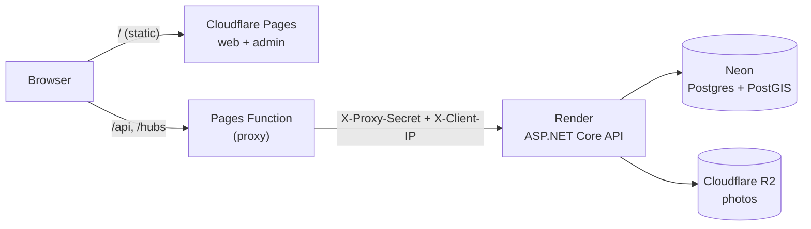

# Deploying MasidBaha

The free-tier setup this repo is wired for:

| Piece | Service | Configured by |
|---|---|---|
| Database (Postgres + PostGIS) | Neon | a connection string |
| API (.NET container) | Render | `render.yaml` |
| Photos | Cloudflare R2 | `Storage__*` settings |
| Public site and admin panel | Cloudflare Pages (two projects) | `.github/workflows/deploy-pages.yml` |



**Why a proxy?** The sites and the API live on different domains (`*.pages.dev` and `*.onrender.com`),
and browsers treat that as cross-site: cookies would need `SameSite=None` and get blocked by Safari and
by Chrome's third-party cookie settings, which would break the admin login. The Pages Function in
`frontend/functions/[[path]].js` forwards `/api`, `/hubs` and `/uploads` to Render, so the browser only
ever talks to its own origin. The cookies stay first-party and no CORS is needed.

Because the API only sees the proxy as its caller, the Function passes the visitor's address in
`X-Client-IP` together with a shared secret (`X-Proxy-Secret`). The API trusts that address (for rate
limits and IP bans) only when the secret matches, so nobody can pick their own.

Free-tier limits change, so check each service's current plan before relying on it.

## 1. Neon (database)

1. Create a project. Pick the region closest to your Render region (Singapore for both works well).
2. Open **Connect** and turn **off** "Connection pooling", so you get the direct host (it has no `-pooler`
   in its name). The pooler is for many short connections; this API keeps a small pool of its own.
3. Write the connection string in Npgsql format:

   ```
   Host=<endpoint>.<region>.aws.neon.tech;Port=5432;Database=neondb;Username=<role>;Password=<password>;SSL Mode=Require;Timeout=30
   ```

The first migration runs `CREATE EXTENSION postgis`, which the default Neon role is allowed to do. Neon
suspends an idle database on the free plan; the `Timeout=30` gives the first request after a pause time
to wake it.

## 2. Cloudflare R2 (photos)

Render's disk is wiped on every deploy, so photos cannot live on it.

1. Create a bucket (for example `masidbaha-photos`) and make it publicly readable (enable the `r2.dev`
   address, or attach a custom domain such as `photos.yourdomain.com`).
2. Create an **API token** with *Object Read & Write* on that bucket. Note the access key id, the secret
   and the account's S3 endpoint (`https://<account-id>.r2.cloudflarestorage.com`).

You will need these for the API: `Storage__S3__ServiceUrl` (the endpoint), `Bucket`, `AccessKey`,
`SecretKey`, and `PublicBaseUrl` (the public address from step 1).

## 3. Render (API)

1. In Render, choose **New > Blueprint**, pick this repository, and apply `render.yaml`.
2. Fill the secret values when asked:

   | Variable | Value |
   |---|---|
   | `ConnectionStrings__MasidBahaDb` | the Neon string from step 1 |
   | `Security__TrustedProxySecret` | a random string of 32+ characters (keep it, Cloudflare needs the same one) |
   | `AdminAuth__InitialAdmin__Email` / `__Password` | the first SuperAdmin (a real email; password 12+ characters) |
   | `Storage__S3__*` | the R2 values from step 2 |
   | `Vapid__*` | optional web push keys; leave empty to run without push |

   `Security__SessionSigningKey` is generated by Render. Changing it later signs every visitor out.

   Generate the proxy secret with `openssl rand -base64 36`, or in PowerShell:
   `[Convert]::ToBase64String((1..36 | % { Get-Random -Max 256 }) -as [byte[]])`.

3. Wait for the first deploy. The API creates the database tables and the first admin on its own.
   Check `https://<service>.onrender.com/health` answers `Healthy`.
4. After the first sign-in works, **delete the two `AdminAuth__InitialAdmin__*` variables**. They are only
   used while no SuperAdmin exists, and the password should not stay in the dashboard.

Render deploys again when CI passes on `master` (`autoDeployTrigger: checksPass`).

## 4. Cloudflare Pages (the two sites)

Create the two projects once, from a terminal in `frontend/`:

```
npx wrangler login
npx wrangler pages project create masidbaha       --production-branch main
npx wrangler pages project create masidbaha-admin --production-branch main
```

In **each** project, open *Settings > Variables and Secrets* and add (Production):

| Name | Type | Value |
|---|---|---|
| `API_ORIGIN` | Text | `https://<service>.onrender.com` |
| `PROXY_SECRET` | Secret | the same value as `Security__TrustedProxySecret` on Render |

Then in the GitHub repository, *Settings > Secrets and variables > Actions*:

| Name | Kind | Value |
|---|---|---|
| `CLOUDFLARE_API_TOKEN` | Secret | an API token with *Cloudflare Pages: Edit* |
| `CLOUDFLARE_ACCOUNT_ID` | Secret | your account id (right sidebar of the dashboard) |
| `CF_PAGES_WEB`, `CF_PAGES_ADMIN` | Variable | only if your project names differ from the two above |
| `PUBLIC_SITE_URL` | Variable | the public site's address, so the admin's "Live map" link goes there |

Run **Actions > Deploy sites to Cloudflare Pages > Run workflow** once. After that it runs by itself
whenever `frontend/` changes on `master`.

Attach your own domain to each Pages project under *Custom domains* (HTTPS is automatic). HTTPS is
required for push notifications and for the phone's location prompt.

## 5. Keeping the free API awake

A free Render service sleeps after about 15 minutes without traffic, and the first request afterwards
takes up to a minute. An uptime monitor (UptimeRobot, Better Stack) pinging
`https://<service>.onrender.com/health` every 5 to 10 minutes keeps it up. Check the provider's terms
first. `/health` does not touch the database, so it does not wake Neon.

## Checklist after deploying

- [ ] The public site opens, the map shows, and a test report appears.
- [ ] The admin site signs in, then **My account**: change the password and turn on two-factor.
- [ ] `AdminAuth__InitialAdmin__*` removed from Render.
- [ ] A photo upload works (proves R2 is configured).
- [ ] Optional: restrict the admin Pages project with Cloudflare Access so only staff can even load it.

## Troubleshooting

| Symptom | Likely cause |
|---|---|
| The sites show "The API proxy is not configured" | `API_ORIGIN` or `PROXY_SECRET` is missing on that Pages project |
| Everyone hits "too many requests" together | `PROXY_SECRET` differs from `Security__TrustedProxySecret`, so every visitor looks like the proxy |
| The first request after a quiet spell fails | Render or Neon was asleep; retry, or use the uptime ping above |
| Photo upload fails | One of the `Storage__S3__*` values is wrong, or the token lacks write access |
| Admin cannot sign in after deploy | The API log says why: a short password, an invalid email, or no admin variables set |
